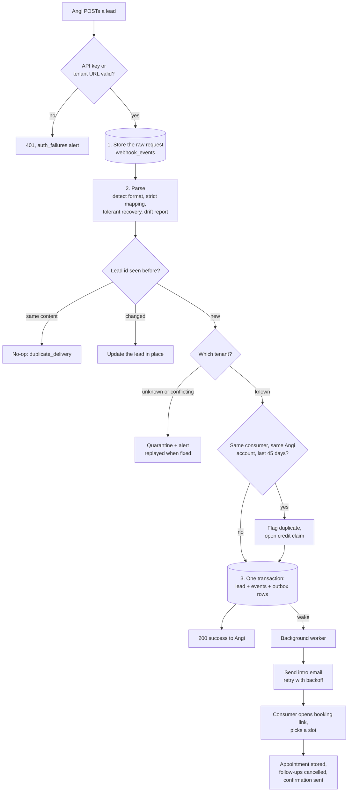

# Angi lead integration

A working integration between **Angi** (a third-party lead aggregator) and a multi-tenant
system like Netic's. Angi POSTs a lead; this service stores it, works out which tenant
(business) it belongs to, and emails the consumer within a couple of seconds to start booking
an appointment.

Built for the Netic Deployment Engineer project. Python 3.12, FastAPI, SQLite.

| Requirement | Where |
|---|---|
| Host an API route for Angi to send leads to | `POST /webhooks/angi/leads` ([app/routes/webhooks.py](app/routes/webhooks.py)) |
| Store lead data in a database | SQLite, schema in [app/schema.sql](app/schema.sql); the raw request is stored before anything else happens |
| Email the address in the lead to start booking | Intro email with a self-service booking link, sent by a background worker ([app/worker.py](app/worker.py)) |
| Map the payload to an existing tenant | `ALAccountId` / `spEntityId` → tenant, plus two stronger signals ([app/tenants.py](app/tenants.py)) |
| Speed to lead / conversion | First response within a couple of seconds, follow-up cadence, self-service booking — [built](#1-maximise-conversion-efficiency) |
| Analytics | Funnel, speed-to-lead, cost per booking, ROI — [built](#2-analytics) |
| Duplicate leads and rebates | Detection, credit claims with evidence, CSV export — [built](#3-duplicate-leads-and-rebates) |
| Monitoring | Schema-drift detection, quarantine and replay, health checks, alerts, canary — [built](#4-monitoring) |

The reasoning behind each decision, with sources, is in [docs/DESIGN.md](docs/DESIGN.md).
A script for presenting it is in [docs/DEMO.md](docs/DEMO.md).

---

## Run it

Requirements: [uv](https://docs.astral.sh/uv/) and, for a public URL, [ngrok](https://ngrok.com/).

```bash
make install                 # uv sync
cp .env.example .env         # then fill in the values described below
make run                     # http://localhost:8000
make tunnel                  # in a second terminal: ngrok -> https://<your-domain>.ngrok-free.dev
```

In `.env`:

| Setting | What to put |
|---|---|
| `PUBLIC_BASE_URL` | Your ngrok https URL. Booking links in emails are built from it. |
| `ANGI_WEBHOOK_API_KEYS` | A secret of your choice. Angi (or a tester) sends it in the `X-API-KEY` header. |
| `ADMIN_TOKEN` | Password for the dashboard, the admin API and `/metrics`. |
| `EMAIL_PROVIDER` | `smtp` to send real email, `console` to write `.eml` files to `data/outbox/` instead. |
| `SMTP_USERNAME`, `SMTP_PASSWORD` | A Gmail address and an [app password](https://myaccount.google.com/apppasswords). Gmail SMTP is used because it can reach any recipient without owning a domain. Mail is sent from that address (`EMAIL_FROM_ADDRESS` can stay empty). |

Every setting is explained in [.env.example](.env.example).

Demo tenants and their Angi account mappings are created on first start with an empty
database ([app/seed.py](app/seed.py)), except in production; all of it is fictional.

| Tenant | Angi account ids that map to it |
|---|---|
| Sparkle Home Cleaning (Indianapolis) | `ALAccountId` **123456** — the id in Angi's spec example |
| Summit Heating & Air (Denver) | `ALAccountId` **200001**, `spEntityId` **12345678** |
| BlueLine Plumbing (Austin) | `ALAccountId` **200002**, `spEntityId` **567890123** |
| Synthetic Canary Co. (monitoring probe) | `ALAccountId` **999999** |

A lead for any other account id is stored and quarantined until the account is mapped
(see [Tenant mapping](#tenant-mapping)).

### Send a lead

This is the example from Angi's own spec. Put the key from `ANGI_WEBHOOK_API_KEYS` in the
header and your own address in `Email`, and the intro email arrives in your inbox.

```bash
curl -X POST "http://localhost:8000/webhooks/angi/leads" \
  -H "X-API-KEY: <your key>" \
  -H "Content-Type: application/json" \
  -d '{
    "FirstName": "Bob",
    "LastName": "Builder",
    "PhoneNumber": "5554332646",
    "PostalAddress": {
      "AddressFirstLine": "123 Main St.",
      "AddressSecondLine": "",
      "City": "Indianapolis",
      "State": "IN",
      "PostalCode": "46203"
    },
    "Email": "you@example.com",
    "Source": "Angie'\''s List Quote Request",
    "Description": "Looking for recurring house cleaning services please.",
    "Category": "Indianapolis – House Cleaning",
    "Urgency": "This Week",
    "CorrelationId": "61a7de56-dba3-4e59-8e2a-3fa827f84f7f",
    "ALAccountId": "123456"
  }'
```

```json
{
  "status": "success",
  "result": "processed",
  "message": "Lead received.",
  "eventId": "evt_5d0c1b7e9a3f4c21",
  "leadId": "lead_92b23f5c07014388",
  "tenant": { "id": "tnt_sparkle", "name": "Sparkle Home Cleaning", "routedBy": "account_id" },
  "format": "angi_ads",
  "parseMode": "strict",
  "duplicate": null,
  "email": { "status": "queued", "template": "intro", "to": "you@example.com", "followUpsScheduled": 2 },
  "warnings": []
}
```

With `you@example.com` left in, the lead is stored but no email leaves: addresses on
example.com, example.org and example.net are reserved for documentation, and the worker
never hands one to a real mail server. With `EMAIL_PROVIDER` set to `smtp` or `resend` the
message is marked failed with "address is on a reserved example domain; nothing was sent";
with `console` it is written to `data/outbox/` like any other. The address printed in
Angi's own example payload is held back the same way: whoever tests an integration posts
that example sooner or later, and the mailbox may belong to somebody.

`CorrelationId` identifies the lead within one Angi account. Send the same body again and
you get `"result": "duplicate_delivery"` and no second email. Change something else and
keep the id, and the stored lead is corrected (`"updated"`). Change the id and it is a new
lead; if the phone or the email is one this Angi account has sent in the last 45 days, it
is also flagged as a duplicate lead.

`scripts/send_lead.py` does the routine part: every run is a new lead (fresh id) from a
new consumer (fresh fictional phone number), addressed to you:

```bash
make send EMAIL=you@example.com                                # the spec example; use your own address
make send EMAIL=you@example.com SAMPLE=angi_ads_emergency_hvac # a different tenant
uv run python scripts/send_lead.py --help                      # redeliveries, repeat requests, both formats
```

Every sample in [samples/](samples/) is described in [samples/README.md](samples/README.md).
They only contain @example.com addresses, and `send_lead.py` refuses to send a payload
with any other address unless it is the one you gave with `--email`.

### Look at what happened

Open `PUBLIC_BASE_URL/dashboard` (any username, password = `ADMIN_TOKEN`).

| Page | Shows |
|---|---|
| Overview | Funnel, speed to lead, spend, cost per booking, leads per day |
| Leads | Every lead; each one has a timeline, the emails sent (a failed one can be retried), the raw payload, and a form to record won / lost |
| Credits | Duplicate leads worth a credit from Angi, with evidence and a CSV export |
| Monitoring | Health checks, alerts, payload shapes seen, and the stored webhook events with their actions: replay, discard, assign a tenant |
| Tenants | Tenants, their Angi account mappings, and their webhook URLs |

`make simulate` fills an empty database with two weeks of realistic history so these
pages have something to show (it never sends real email). Stop the service first and
start it again afterwards: a running worker picks up the simulated follow-ups.

---

## How it works



The ideas that shape the code:

1. **Store first, then think.** The raw request is written to `webhook_events` before
   any parsing, and the commit is synced to disk before Angi is answered. Whatever goes
   wrong afterwards (Angi changed the format, a tenant is not mapped yet, we have a bug)
   the lead is on disk and can be replayed. No request that passed authentication and the
   size limit is dropped.

2. **Answer Angi the way Angi's spec requires.** Angi counts only HTTP 200 with a success
   body as delivered; anything else is retried three times, fifteen minutes apart, and
   then Angi emails the business. So everything we managed to store is answered
   `200 {"status": "success", "result": ...}`, where `result` says what really happened.
   A retry of the same payload cannot fix an unmapped tenant or a parser bug on our side;
   only a replay of the stored event can, and fifteen minutes is far too slow for a lead
   anyway.

3. **Idempotent on Angi's lead id.** Angi retries, so the same lead can arrive more than
   once. `leads.idempotency_key` (the lead id within one Angi account) is unique, and
   intake runs in a `BEGIN IMMEDIATE` transaction, so even simultaneous deliveries of one
   lead produce one row and one email. An older delivery never overwrites a newer one.

4. **The email is queued in the same transaction as the lead** (a transactional outbox).
   "Lead stored" therefore always implies "email queued"; a crash in between cannot lose
   the email. The worker is woken the moment the transaction commits, so the email
   is normally accepted by the mail server about two seconds after the request arrived
   (measured against Gmail), and the webhook itself never waits on a mail server.

5. **Parsing is tolerant by design.** Each Angi format is a table of fields
   ([app/angi/formats.py](app/angi/formats.py)). A payload that stops matching (renamed
   key, new casing, an extra wrapper, a missing field) is still answered: missing fields
   are recovered by alias where possible, and the deviation is recorded and alerted on.

6. **Never guess the tenant.** The email goes out under a business's name. A lead for an
   Angi account we cannot map is quarantined and alerted on, then processed automatically
   the moment someone adds the mapping. So is a lead whose routing signals disagree: a
   tenant's URL does not win over an account id that is mapped to another tenant.

### Code map

| File | Responsibility |
|---|---|
| [app/routes/webhooks.py](app/routes/webhooks.py) | The HTTP route: authenticate, read the body, hand over |
| [app/ingest.py](app/ingest.py) | The pipeline: store → parse → idempotency → tenant → duplicate → persist → queue email |
| [app/angi/formats.py](app/angi/formats.py), [parser.py](app/angi/parser.py) | The two Angi payload formats as data; strict + tolerant parsing; drift detection |
| [app/tenants.py](app/tenants.py) | Tenant mapping |
| [app/security.py](app/security.py) | Webhook key and admin token checks; the cross-site check for operator actions |
| [app/duplicates.py](app/duplicates.py), [credits.py](app/credits.py) | Duplicate detection; credit claims, eligibility, CSV evidence |
| [app/outbox.py](app/outbox.py), [worker.py](app/worker.py), [cadence.py](app/cadence.py) | Outbox queue; delivery with retries; follow-up timing |
| [app/mailer/](app/mailer/) | Email rendering and providers (SMTP, Resend, console) |
| [app/booking.py](app/booking.py), [routes/public.py](app/routes/public.py) | Slots, booking and unsubscribe pages |
| [app/analytics.py](app/analytics.py) | Funnel, speed to lead, money |
| [app/monitoring.py](app/monitoring.py), [alerts.py](app/alerts.py) | Health checks, alerts, notifications |
| [app/routes/admin.py](app/routes/admin.py), [dashboard.py](app/routes/dashboard.py) | Operator JSON API and dashboard |
| [app/schema.sql](app/schema.sql) | Every table, with comments |

---

## The webhook

```
POST /webhooks/angi/leads                  shared URL, X-API-KEY header required
POST /webhooks/angi/leads/{webhook_key}    tenant-specific secret URL, no header needed
```

**Authentication.** Angi supports exactly one mechanism: a key you choose, sent back in
the `X-API-KEY` header. `ANGI_WEBHOOK_API_KEYS` accepts several comma-separated keys so
one can be rotated without downtime. The key is compared in constant time. It is never
stored: credential headers are redacted before the request is saved. For a sender that
cannot set a custom header the same key is also accepted as a bearer token, a basic-auth
password or an `api_key` query parameter; a key that travels in the URL (that parameter,
or a tenant's webhook key) is redacted in the access log. Every rejected request is counted
on one `auth_failures` alert.

**Payload.** Angi has two lead feeds with different shapes, and both are accepted:

| | Angi Ads (the spec this was built against) | Angi Leads (formerly HomeAdvisor) |
|---|---|---|
| Shape | PascalCase, nested `PostalAddress` | flat camelCase, `interview[]` |
| Lead id | `CorrelationId` | `leadOid` |
| Business | `ALAccountId` | `spEntityId`, `crmKey` |
| Price | not in the payload (configured per account) | `fee` |

**Responses.**

| HTTP | Body | Meaning |
|---|---|---|
| 200 | `"status": "success", "result": "processed"` | New lead stored and mapped to a tenant; the email is queued (or skipped: no usable address, or the address unsubscribed) |
| 200 | `"result": "duplicate_delivery"` | Lead id already known and this delivery has nothing newer: nothing done |
| 200 | `"result": "updated"` | Lead id already known, newer content: the lead is corrected in place. A corrected email address re-addresses whatever has not been sent yet and gets one first email of its own (with the follow-ups, if the lead had not been reached before), unless the lead has already booked, was closed or opted out |
| 200 | `"result": "quarantined"` | Stored, not processed, alert raised. `reason` says why (below) |
| 200 | `"result": "accepted"` | Stored; processing failed on our side and is retried automatically |
| 400 | `"status": "error", "result": "rejected"` | The body cannot be read as one JSON object: empty, not JSON and not salvageable, an array of several items, two objects glued together. Still stored, for forensics |
| 401 | `"status": "error", "result": "unauthorized"` | Missing or wrong key, or an unknown tenant URL. Not stored |
| 413 | `"status": "error", "result": "rejected"` | Body larger than `MAX_BODY_BYTES`. Not stored |

Why a request is quarantined (`reason`), and what releases it:

| `reason` | Meaning | Released by |
|---|---|---|
| `unmapped_account` | The Angi account id in the payload is not mapped to a tenant | Adding the mapping |
| `no_account_id` | The payload names no Angi account and nothing else identifies the tenant | An operator assigning a tenant to the event |
| `tenant_inactive` | The tenant it routes to is deactivated | Re-pointing the account's mapping to an active tenant (the waiting leads are replayed at once; one that arrived on the deactivated tenant's own URL or with its crmKey stays quarantined), or reactivating the tenant and then a replay. Deactivating and reactivating is a change to `tenants.is_active` in the database; there is no screen or endpoint for it |
| `mapping_conflict` | It arrived on one tenant's URL (or with its crmKey) but its account id is mapped to another tenant | Re-pointing the mapping at the tenant whose URL was used (replayed automatically). If the mapping is right and the URL was wrong: correct the URL at Angi for future leads, and release the stored request with `POST /admin/api/events/{id}/replay` and `{"tenant_id": "<the mapped tenant>"}` |
| `tenant_conflict` | It carries the lead id of a lead that belongs to a different tenant than the one the request was authenticated for | Nothing automatic: one tenant's request never changes another tenant's lead |
| `unrecognised_payload` | No known Angi format and no contact details to recover | A parser fix and a replay, or discarding it (a ping, junk) |

## Tenant mapping

A lead finds its tenant by the first of these that applies:

1. **Tenant-specific URL** — `/webhooks/angi/leads/{webhook_key}` was issued to one tenant.
2. **`crmKey`** — Angi lets the integrator set a routing value per business and echoes it
   back in every lead (Angi Leads feed). We give Angi the tenant id.
3. **Angi account id** — `ALAccountId` / `spEntityId`, looked up in `tenant_lead_sources`.
   One tenant can own many Angi accounts.
4. **Fallback tenant** — only if `FALLBACK_TENANT_SLUG` is set. Off by default, and
   production refuses to start with it.
5. Otherwise **quarantine**. Adding the mapping (dashboard → Tenants, or
   `POST /admin/api/tenants/{id}/lead-sources`) immediately processes the leads of that
   account that were waiting, and closes the alert about it.

The signals have to agree. If 1 or 2 names one tenant and the account id in the payload is
mapped to another, the URL does not win: the lead is quarantined (`mapping_conflict`),
because either the mapping or the URL registered with Angi is wrong and a person has to
say which.

When 1 or 2 identifies the tenant and the payload carries an account id we have not seen,
the mapping is learned automatically, an info alert (`mapping_learned`) says so, and any
leads of that account waiting in quarantine are released.

A payload with no account id that arrives on the shared URL cannot be routed by any
mapping (`no_account_id`). An operator who knows which business it is for assigns the
tenant on the Monitoring page (or with `POST /admin/api/events/{id}/replay` and a
`tenant_id`), and the stored request is processed for that tenant.

## Operator actions

What an operator does is a button on the dashboard and an endpoint of the admin API
(`/admin/api/...`, same admin token), so it can be scripted.

| Action | Dashboard | Admin API |
|---|---|---|
| Map an Angi account to a tenant | Tenants → Add mapping | `POST /admin/api/tenants/{id}/lead-sources` |
| Replay a stored request | Monitoring → Replay | `POST /admin/api/events/{id}/replay` |
| Assign a tenant to a request with no account id | Monitoring → Assign and replay | `POST /admin/api/events/{id}/replay` with `{"tenant_id": "..."}` |
| Discard a request that will never be a lead (a ping, junk, a test) | Monitoring → Discard | `POST /admin/api/events/{id}/discard` |
| Retry an email that was given up on | Lead page → Messages → Retry | `POST /admin/api/messages/{id}/retry` |
| Record that a job was won or lost | Lead page → Record the outcome | `POST /admin/api/leads/{id}/outcome` |
| Move a credit claim along | Credits → Save | `POST /admin/api/claims/{id}/status` |
| Close an alert | Monitoring → Resolve | `POST /admin/api/alerts/{id}/resolve` |

A discarded request leaves the quarantine (so the backlog check can clear) but stays in
`webhook_events` with its raw body. The browser sends the admin credentials with every
request to the site, so every dashboard and admin POST that names an `Origin` must name
ours; a form on another site cannot press these buttons.

---

## The four challenges

### 1. Maximise conversion efficiency

*Built:*

- **Speed to lead measured in seconds.** The webhook does only a database write; the
  worker is woken immediately and sends the email. `received_at → first_contacted_at` is
  recorded per lead and reported as p50 / p90.
- **A first message about their job, not a form letter.** It names the service and the
  city, plays back the location and timing they gave Angi (on the Angi Leads feed also
  their first three interview answers; not the free-text description), and offers the next three
  real arrival windows as links that open the booking page with that window selected.
- **Self-service booking.** `/book/{token}` lets the consumer pick a window and confirm
  it, without waiting for anyone to call back.
- **Follow-up cadence with stop conditions.** Nudges at +1 hour and +1 day (configurable),
  never between 8 PM and 8 AM in the tenant's time zone (checked again at the moment of
  sending) and never within 30 minutes of another email to the same address. Cancelled
  when the consumer books (through this lead, or another of theirs from the last 45
  days), unsubscribes, the lead is closed, or the first email could not be delivered.
  When several nudges of one lead are overdue at once (the service was down, or two
  were held until the same morning), only the latest is sent and the earlier ones are
  cancelled as `superseded`.
- **Retries that prioritise new leads.** A failed send is retried after 5 s, 30 s, 2 min
  and 10 min. A lead's first response is then retried every 30 minutes for another 24
  hours before it is given up; a follow-up is never sent before that first response has
  gone out. First responses always jump ahead of queued follow-ups.

*Designed, not built:* SMS and an outbound AI voice call in the first minute (Angi's own
data is about calling), using the consent flag Angi sends (`automatedContactCompliant`);
reply handling so a consumer's answer goes to the AI agent; prioritising by urgency and
job value. See [docs/DESIGN.md](docs/DESIGN.md#1-maximise-conversion-efficiency).

### 2. Analytics

*Built:* every lead carries funnel timestamps (received → contacted → engaged → booked →
won/lost), its cost, and — once the job closes — its value. From those:
lead-to-booked rate, step conversion, speed-to-lead percentiles, cost per lead / booking /
won job, revenue and return on spend, duplicate rate and credits recovered, and bookings
attributed to the intro versus a follow-up. The funnel is cumulative: a job recorded as
won counts as booked in the funnel, the rates, the cost figures and every breakdown,
whether it was booked through the link or by phone. Two numbers count link bookings only,
because a phone booking has no booking time: bookings by touch and time to book.

What is broken down, and what is not: booking rate, spend, cost per booking and revenue
are broken down by tenant, service, ZIP and feed; volume and bookings by day and by hour
of day. Everything else (speed to lead, step conversion, duplicates, credits, attribution)
is computed overall, for any one tenant and for any period. The Overview page shows the
tenant and service tables and the per-day chart; the rest is in
`GET /admin/api/analytics/summary`.

`POST /admin/api/leads/{id}/outcome` is how a tenant's field-service system reports that a
job was won and what it was worth.

### 3. Duplicate leads and rebates

*Built:* Angi's rule is "charged twice for the same lead/homeowner within 45 days". Every
new lead is compared with the last 45 days of leads the tenant got through the same Angi
account (a lead that names no account is compared with all of the tenant's), on
normalised phone, email and Angi service-request id. A match is flagged and a
**credit claim** is opened with everything Angi asks for: both lead ids, both timestamps,
what matched, the fee, when we first contacted the homeowner, and the deadline (30 days
from the charge). Angi's condition is a *call* attempt within 24 hours; what this system
makes and can prove is an email, and the claim says so. The Credits page is a worklist
ordered by deadline with ready-to-paste request text and a CSV export; claims are tracked
through submitted → credited / denied so the tenant can see dollars recovered.

A duplicate lead is answered like any other, with one difference: if that same address
already got (or is about to get) a first email from the tenant in the window, the new
request is acknowledged with a short "we got your new request" note instead of a second
introduction and a second round of follow-ups. An address that has never heard from the
business gets the normal introduction, duplicate or not.

Angi has no API for credit requests and its terms forbid scripting the pro portal, so the
final step is a person pasting the prepared text. Redeliveries of the *same* lead id are
not duplicates in this sense (the tenant was charged once) and never create a claim.
Leads of the test tenant (the canary) are never checked for duplicates.

### 4. Monitoring

*Built:*

- **Format drift is detected per payload**, against the documented field tables: new
  fields (info), missing or re-typed fields and fields recovered by alias (warning), an
  unknown format (critical). One alert per kind of deviation, with a counter.
- **Nothing is lost while we fix it.** Affected leads are still answered if an email
  address can be found; the rest wait in quarantine and are replayed from the dashboard.
- **Health checks** run every minute: ingest error rate, unprocessed events, quarantine
  backlog, emails breaching the speed-to-lead SLA, email that was given up on, and
  **silence** — no leads when a tenant's own history says there should have been some,
  which is the only way to notice that Angi has stopped sending.
- **Synthetic canary** (`scripts/canary.py`): posts a lead through the public URL and
  verifies the email went out, to tell "Angi stopped sending" from "we are broken". With
  `CANARY_INTERVAL_MINUTES` set, a canary that stops arriving is an alert too.
- **Alerts** go to the log, Slack and email. An alert is announced when it opens, again
  when it gets worse, and at most once a day while it keeps recurring. `/healthz` and
  `/readyz` are open for load balancers and uptime probes; the Prometheus `/metrics`
  endpoint needs the admin token.

---

## Tests

```bash
make test     # uv run pytest
make lint     # uv run ruff check .
```

Most tests drive the real application through HTTP with a controllable clock and an
in-memory mail provider; the parser, the body decoder and the helpers are tested
directly. Nothing on the normal path is mocked: internals are patched only to inject a
fault (a crash in the middle of the pipeline, a locked database, a send that cannot be
recorded) or, in four tests, to record that the worker was woken; the external edges
(SMTP, Resend, Slack) are faked. They cover the
payload parser (including fuzzing and Angi's own invalid-JSON example), authentication,
idempotency under concurrent delivery, tenant mapping, failure and crash recovery, email
delivery and retries, booking races, duplicate detection, credit eligibility, analytics
arithmetic, every health check, and the dashboard.

## What it does not do

Being straightforward about the edges of a one-day build:

- **Email only.** No SMS or voice; the consent flag is stored for when there is.
- **Replies are not processed.** They go to the sending mailbox (or to the Reply-To
  address, if one is configured for the tenant or globally); nothing reads them.
- **Availability is generated** from business hours, one job per window. `app/booking.py`
  is the seam where a real scheduling system plugs in.
- **Single node.** SQLite and an in-process worker thread. The SQL is portable and the
  worker is driven entirely by database rows, so the path to Postgres and separate worker
  processes is short, but it has not been taken.
- **At-least-once email.** If the mail server accepted a message but its acknowledgement
  was lost or timed out, the message is sent again straight away on a new connection; if
  the process dies after acceptance but before that was recorded, it is sent again when
  the worker comes back. A message is never dropped to avoid this.
- **Engagement is measured by booking-link opens**, which mail scanners that follow links
  can inflate. Booking itself is a POST and cannot be triggered that way.
- **One namespace for Angi account ids.** `ALAccountId` (Angi Ads) and `spEntityId` (Angi
  Leads) come from two Angi systems but are looked up in one table. If two tenants ever
  had the same number in the two feeds, only one of them could be mapped, and that tenant
  would get both feeds' leads. The fix is to scope the mapping by feed; it is not built.
- **Credit requests are prepared, not filed.** Angi offers no API for that. And Angi asks
  for a call attempt, where this system records an email.
- **No button to deactivate a tenant.** `tenants.is_active` is honoured everywhere
  (routing, email, the booking page, the silence check), but nothing in the dashboard or
  the admin API sets it. Taking a tenant out of service, or bringing it back, is
  `UPDATE tenants SET is_active = 0 WHERE slug = '...'` (or `= 1`) on the database.
- **Not seen real Angi traffic.** Both formats are implemented from Angi's documentation;
  the first real test lead should be diffed against the field tables.
