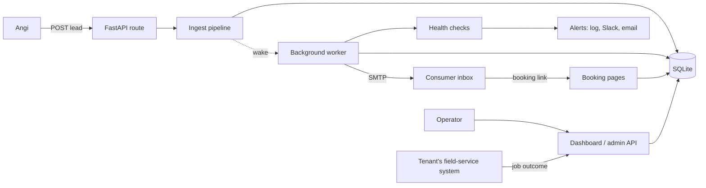

# Design notes

Why the system is built the way it is, what each of the four challenges needs, what was
built, and what I would do next. The README says *what* it does; this says *why*.

- [What Angi actually sends](#what-angi-actually-sends)
- [Architecture](#architecture)
- [1. Maximise conversion efficiency](#1-maximise-conversion-efficiency)
- [2. Analytics](#2-analytics)
- [3. Duplicate leads and rebates](#3-duplicate-leads-and-rebates)
- [4. Monitoring](#4-monitoring)
- [Security and compliance](#security-and-compliance)
- [From prototype to production](#from-prototype-to-production)
- [Sources](#sources)

---

## What Angi actually sends

I read Angi's documentation before writing any code, because the integration has to honour
Angi's side of the contract, not just accept a JSON body. Four facts shaped the design.

**1. There are two feeds with different payloads.**

| | Angi Ads ("JSON Lead Feed", formerly Angie's List) | Angi Leads ("Lead Integration API", formerly HomeAdvisor) |
|---|---|---|
| Keys | PascalCase, nested `PostalAddress` | flat camelCase |
| Lead id | `CorrelationId` (GUID) | `leadOid` (integer) |
| Business | `ALAccountId` | `spEntityId` (only "sometimes" sent), `crmKey` |
| Price | none | `fee` |
| Extras | `Category` ("Indianapolis – House Cleaning"), `Urgency` | `interview[]`, masked phone details, consent flag, optional `appointment` |

The project's documentation is the first; a tenant on the other product gets the second.
Both are implemented as field tables in `app/angi/formats.py`, and the parser picks one
by its distinctive keys. Everything after the parser works on one canonical
`NormalizedLead`, so a third format is one more table.

**2. Authentication is one shared key.** Angi sends a key of our choosing in an
`X-API-KEY` header. There is no signature, no OAuth and no fixed IP range. That is weak
(anyone holding the key can post), so the key is rotatable, a tenant-specific secret URL
is offered as an alternative, and every rejected request is counted on an alert.

**3. Only "HTTP 200 + a success body" counts as delivered.** Both specs say so. Anything
else is retried three times at fifteen-minute intervals, after which Angi emails the
business. Angi asks for a response within 2–5 seconds.

**4. Angi's own example is not valid JSON.** The sample in the JSON Lead Feed spec has
curly quotes, an unquoted email address and a missing comma. I took that as a warning
about how carefully the format is maintained, and it is why the parser is tolerant and
why a body that is *almost* JSON is salvaged rather than rejected.

### What follows from the response contract

Most webhook handlers answer `4xx` for a payload they cannot process. Here that would be
a mistake:

- A `4xx` tells Angi to retry. Retrying the same payload cannot fix an unmapped tenant, a
  parser that needs updating, or a bug: those are ours to fix.
- The retry arrives fifteen minutes later. For a lead, that is already too late.
- After three failures Angi emails the business owner that their integration is broken.

So the rule is: **if the request is safely stored, answer success**; the `result` field
says what really happened (`processed`, `duplicate_delivery`, `updated`, `quarantined`,
`accepted`). Recovery is our job, done by replaying the stored event, and our own alert
fires in seconds. The only failures returned are the ones where a retry or a human at the
sender might help: bad credentials (401), a body that cannot be read as one JSON object
(400, still stored), a body that is too large (413).

Angi's retries are still useful as a backstop for the one case we cannot handle
ourselves, which is being completely down. Because intake is idempotent on the lead id,
those retries are harmless when they arrive.

"Safely stored" is meant literally. SQLite runs in WAL mode with `synchronous = FULL`, so
the commit that stores the request is synced before the 200 is sent, and a power cut a
moment later does not take the lead with it. (On macOS a sync stops at the drive's own
cache unless `fullfsync` is switched on; the demo runs on a laptop, a production host
would be Linux.)

---

## Architecture



### Data model

| Table | One row per | Why it exists |
|---|---|---|
| `tenants` | business | Who we answer leads for |
| `tenant_lead_sources` | Angi account | **The mapping**: Angi account id → tenant, plus what that account pays per lead |
| `webhook_events` | HTTP request | The raw request, stored first. Audit trail, replay source, idempotency evidence. Its status is one of received, processed, duplicate_delivery, quarantined, rejected, failed, discarded |
| `leads` | lead | Canonical lead, funnel timestamps, cost, outcome |
| `lead_events` | thing that happened to a lead | Append-only timeline; the audit trail behind every number |
| `outbox_messages` | email to send | Transactional outbox: queue, retries, follow-up schedule, audit copy of what was sent |
| `appointments` | booking | Unique indexes stop double-booking |
| `email_suppressions` | opted-out address | Unsubscribes, per tenant |
| `credit_claims` | lead worth a credit | Duplicate evidence and claim status |
| `payload_shapes` | distinct payload deviation | What formats we have actually seen |
| `alerts` | open problem | One row per problem, with a counter |

Timestamps are fixed-width UTC strings (so string order is time order) and money is
integer cents (so nothing is ever a rounding error).

### The pipeline, and what each step protects against

| Step | Protects against |
|---|---|
| Store the raw request before parsing | Losing a lead to a format change, a bug or a missing mapping |
| Detect format, strict mapping, then alias recovery | Renamed, re-cased, wrapped or missing fields |
| Unique `idempotency_key` + `BEGIN IMMEDIATE` | Angi's retries and simultaneous deliveries creating two leads or two emails |
| `last_delivery_at` on the lead | An older delivery, processed late, overwriting a newer correction |
| Tenant resolution with quarantine | Emailing a consumer under the wrong business's name |
| Duplicate check inside the same transaction | Missing a credit; sending the same address a second introduction |
| Lead + events + outbox rows in one transaction | A stored lead with no email queued, or the reverse |
| Worker woken on commit, polling as a fallback | Slow first response; a lost wake-up |
| Retry with backoff, then every 30 minutes for a day; stuck-message recovery | A mail-server blip, a longer outage, or a crash mid-send |
| Periodic retry of unfinished events | A crash between "stored" and "processed" |

### Failure modes

| What breaks | What happens | How we find out |
|---|---|---|
| Angi renames or re-cases a field | Lead recovered by alias, answered normally | `schema_drift` alert (warning) naming the field |
| Angi adds a field | Nothing breaks; value kept in `extras` | `schema_drift` alert (info) |
| Angi sends an unrecognisable payload | With an email or a phone in it: stored as a lead and flagged (emailed only if there is an email). With neither: quarantined | Critical alert; ingest error-rate check |
| Angi sends something that is not one JSON object | Almost-JSON is salvaged. Otherwise 400, stored; Angi retries and then emails the business | `invalid_payload` alert |
| Angi stops sending, or sends elsewhere | Nothing arrives | `lead_silence` check; canary still passes, so the fault is upstream |
| Angi changes how it sends the key | 401s | `auth_failures` alert listing the header names seen |
| A tenant's Angi account is not mapped | Quarantined; processed when mapped | Critical alert naming the account |
| A lead arrives on one tenant's URL for an account mapped to another | Quarantined (`mapping_conflict`); nobody is emailed until a person corrects the mapping, or assigns the stored request to the mapped tenant (a corrected URL only helps the leads that come after) | `mapping_conflict` alert naming the account |
| A lead names no Angi account at all | Quarantined (`no_account_id`) until an operator assigns the tenant | Quarantine check; the event on the Monitoring page |
| Mail server down or credentials wrong | Retries at 5 s, 30 s, 2 min, 10 min; a first response then every 30 minutes for 24 hours. After a fix, an email that was given up on can be retried by hand | `email_send_error` alert; SLA backlog check |
| Bad recipient address (the mail server refuses the recipient with a 5xx) | Fails once, no retries; lead flagged for review; its follow-ups are cancelled | Lead timeline; `email_failures` check |
| A demo lead with an @example.com address meets a real mail server | Never handed over: the message is marked failed, "address is on a reserved example domain; nothing was sent" | Lead timeline; `email_failures` check |
| Our process crashes mid-request | Event already stored; retried on restart | `unprocessed` check |
| Our process is down | Angi retries at +15, +30, +45 min; intake is idempotent | External uptime probe on `/readyz`; canary |
| A bug in our pipeline | Transaction rolls back, event marked failed, retried | `processing_error` alert (critical) |

---

## 1. Maximise conversion efficiency

### What the evidence says

Speed matters, but most of the statistics quoted for it are wrong, so it is worth being
precise about what is actually known.

- **Angi's own guidance:** calling within fifteen minutes more than doubles the chance of
  connecting; a second call the next day adds 45%; most closed leads go to the first pro
  to make contact. Each request is matched to up to five pros, so this is a race.
- **Thumbtack:** pros who reply within 30 minutes are 25% more likely to be hired than
  those who reply within three hours.
- **Independent research (Management Science, 2026, 11.6M marketplace interactions):** a
  one-hour delay was associated with a 46% drop in the chance of being hired, and a
  one-day delay with about 90%. The important caveat: **the benefit disappeared when the
  reply looked automated.** Speed works because it signals how responsive you will be.
- **The famous "5 minutes / 21x" figure** (InsideSales/MIT, 2007) is real but is about the
  odds of *reaching and qualifying* a lead, from six companies, and explicitly not about
  sales. "78% of customers buy from the first responder" has no study behind it at all.
  I would not put either in front of a customer.
- **Follow-up:** Leads360's 3.5M-lead study found 93% of converting leads are reached
  within six attempts, contact should be front-loaded on day one, and more than five
  emails before contact *lowers* conversion.

### What was built

| Tactic | Implementation |
|---|---|
| Respond in seconds | Webhook does one database transaction; the worker is woken on commit. Measured per lead as `received_at → first_contacted_at` |
| Do not pay for connection set-up on a lead's clock | The worker keeps one authenticated SMTP connection open and checks it every minute. Measured against Gmail: a new connection costs about 0.4 s and, every so often, 5–10 s (Gmail holds back its greeting); the first live test took 12 s for that reason. With the connection kept warm the email is accepted about 2 s after the request arrives, nearly all of it Gmail accepting the message. A burst of leads gets extra one-off connections rather than queueing behind it |
| Do not look like a bot | The email names their service, city and stated urgency (on the Angi Leads feed also their first three interview answers), comes from the business by name, and invites a reply or a call |
| Remove a round-trip | The email lists the next three real arrival windows as links; `/book/{token}` books in two taps |
| Follow up, then stop | +1 h and +1 day by default; cancelled on booking, unsubscribe or close, and when the first email could not be delivered; capped, because more is worse |
| Respect the hour | The first response goes at any time (email is unobtrusive); follow-ups are not sent between 8 PM and 8 AM local, which is checked when they are scheduled and again when they are sent |
| New leads first | First responses are sent ahead of queued follow-ups, a burst of them in parallel; follow-ups go one at a time, and never before the lead's own first response has gone out |
| Do not nag | A repeat request to an address we already wrote to gets a short acknowledgement, not a second intro and a second cadence; a follow-up is held if we emailed that address in the last 30 minutes, and dropped if the person booked through another lead of theirs from the last 45 days; when several follow-ups of a lead are overdue at once (after downtime), only the latest is sent |
| Never drop a send | Retries at 5 s, 30 s, 2 min, 10 min; a first response is then retried every 30 minutes for 24 hours; a message left mid-send by a crash is re-queued when the worker starts; one that was given up on can be retried from the lead's page |
| Confirm what they did | A booking is confirmed by email even if the address has unsubscribed (it answers an action the person just took); rescheduling cancels an unsent confirmation of the old time |

### What I would build next

1. **Call and text in the first minute.** Angi's evidence is about calling, and its credit
   policy requires a call attempt within 24 hours. An AI voice agent that calls as the
   email goes out is the obvious next step. The payload already tells us whether automated
   calls and texts are permitted (`automatedContactCompliant`, stored per lead) and
   whether the phone number is a temporary masked one that expires. Calls and texts must
   stay inside 8 AM–9 PM in the consumer's time zone.
2. **Handle replies.** Route inbound email and SMS to the AI agent so a consumer who
   answers "Thursday afternoon?" is booked without a human.
3. **Use the appointment Angi already made.** Angi Leads payloads can carry an
   `appointment` the consumer picked on Angi. Those should be confirmed, not asked to
   pick a time again. The object is captured today but not acted on.
4. **Prioritise.** When human follow-up is the bottleneck, order by urgency ("Emergency")
   and typical job value for the service, newest first.
5. **Experiment.** The outbox already records which template was sent, so subject lines,
   timing and cadence can be A/B tested against booking rate.

---

## 2. Analytics

### What has to be stored

Conversion is a funnel over time, so each lead carries a timestamp for every step, and
every step is also an immutable row in `lead_events`:

```
received_at → first_contacted_at → first_engaged_at → booked_at → closed_at (won | lost)
```

Analytics reads the timestamps, never the current `status`, so a lead that booked and was
later lost still counts as a booking. The funnel is cumulative: each stage includes every
lead that got at least that far. A job recorded as won counts as booked even when nobody
used the booking link (it was arranged by phone), so "won" can never exceed "booked" and
the booking rate does not punish a tenant for picking up the phone. Alongside the funnel:

- **Cost** — `fee_cents` from the payload (Angi Leads), or the per-account price
  configured on the mapping (Angi Ads carries no price). A lead with neither counts as
  $0; the summary reports how many there are (`unpriced_leads`) and the Overview page
  says so next to the spend figures.
- **Value** — `job_value_cents`, reported when the job closes.
- **Dimensions** — stored on every lead: tenant, service, market, ZIP, urgency, feed and
  the time received. Which email produced the booking is derived from the outbox.
- **Quality** — duplicate flag, credit status, whether the contact details were usable.

The outcome is the piece this system cannot observe on its own. It arrives through
`POST /admin/api/leads/{id}/outcome`; in production the tenant's field-service system
(ServiceTitan, Housecall Pro, Jobber) would call it when a job is invoiced.

### Metrics, and what each is for

| Metric | Definition | The decision it informs |
|---|---|---|
| Lead-to-booked rate | booked ÷ received | The headline: is Angi spend turning into jobs? |
| Step conversion | contacted → engaged → booked → won | *Where* leads are lost: deliverability, the message, scheduling, or the visit |
| Speed to lead | p50 / p90 of first contact − received; share within 1 and 5 min | Whether we are winning the race; an SLA to alert on |
| Cost per booking, cost per won job | net spend ÷ booked, ÷ won | What a job really costs to acquire |
| Return on spend | revenue ÷ net spend | Whether to raise, hold or cut the Angi budget |
| By tenant / service / ZIP / feed | received, booked, booking rate, spend, cost per booking, revenue | Which task categories and areas to buy more or fewer leads in |
| By day / by hour of day | received and booked (in the tenant's time zone) | Trend; when to staff |
| Duplicate rate; credits recovered | duplicates ÷ received; $ credited | Lead quality; money returned |
| Bookings by touch | booked after intro only vs after a follow-up | Whether the cadence earns its keep |

Net spend subtracts credits actually received, so recovering duplicates shows up as a
lower cost per booking.

Speed to lead, step conversion, duplicates, credits and attribution are computed overall
and per tenant, for any period; they are not broken down further. Urgency, market and
weekday are stored but not yet reported on.

### Limits

Engagement is measured by booking-link opens, which mail scanners can inflate; bookings
are a form POST and cannot be. Email opens are deliberately not tracked: Apple Mail's
privacy proxy makes them meaningless. At real volume these definitions would be SQL over
a warehouse table rather than Python over rows, and the first thing to add would be
cohorting by response-time bucket, to produce our own evidence for how much speed is
worth in each tenant's market.

---

## 3. Duplicate leads and rebates

### Angi's rules

From Angi's help centre and Pro Terms (checked November 2026):

- A credit-eligible duplicate is being "charged twice for the same lead/homeowner within
  45 days".
- Angi will consider a credit only if the lead is under 45 days old, **the pro tried to
  call the homeowner within 24 hours**, the account is in good standing, and the account
  is not on an annual subscription.
- The Pro Terms require disputes "within 30 days of the date such charges are incurred".
  The two numbers conflict; the software uses the stricter one as the deadline.
- Requests are made per lead, by a person, in the Angi for Pros app or website, and
  reviewed within five business days. **There is no API, and the Pro Terms forbid scripts
  against the portal.**
- Credits are account credits that expire after six months, not refunds.

### Two things called "duplicate"

| | Redelivery | Duplicate lead |
|---|---|---|
| What it is | The *same* lead id arrives again (an Angi retry) | The *same person* arrives as a *new* lead id |
| Charged | Once | Twice |
| Handled by | Idempotency: no second lead, no second email | Detection: flagged, credit claim opened |
| Worth a credit | No | Yes |

Conflating them would either double-email consumers or flood the tenant with false claims.

### Detection

When a lead arrives, it is compared with the leads that tenant received through the same
Angi account in the previous 45 days (a credit is claimed from the account that was
charged twice; a lead that names no account is compared with all of the tenant's) on:

- normalised phone (E.164; primary and secondary cross-matched),
- normalised email,
- Angi's service-request id (`srOid`).

Phone and email are normalised first, so `(555) 433-2646` matches `5554332646`. Invalid
numbers never match each other. Masked numbers are excluded entirely: they are temporary
Angi proxies that different consumers can share over time.

Confidence is **high** when the service request is the same, both phone and email match,
or one matches and the service is the same; **medium** when it is the same person asking
about a different service, which Angi may treat as a separate project. Medium claims are
kept but labelled, so the tenant decides.

Two details keep the list honest. Leads can be processed out of order (an earlier one
sits in quarantine while a later one goes through); when the earlier one is finally
processed, the later one is flagged as its duplicate, not the other way round. And leads
of the test tenant, which the canary posts every few minutes from one synthetic consumer,
are never checked.

Which email a duplicate gets is decided by the address, not by the flag. If that address
was already sent a first email by this tenant inside the window (or one is queued), the
new request gets the short "we got your new request" note and no second cadence. If the
address has never heard from the business (the same phone, another email), it gets the
normal introduction and follow-ups: telling a stranger to the inbox "you're already on
our radar" would be wrong.

### What the tenant gets

Maximising rebates is mostly about not missing any and not missing the deadline, so the
feature is a worklist, not a report:

- Every duplicate opens a **claim** the moment it arrives.
- The Credits page lists claims **by deadline**, flags those within seven days, and
  checks each against Angi's conditions: both leads inside the window, the request still
  in time, a contact attempt within 24 hours. Angi asks for a *call* attempt; what this
  system makes in seconds and records is an email, and each claim carries a note saying
  so, so nobody files it believing a call is on record.
- Each claim has **ready-to-paste request text** naming both lead ids, both timestamps,
  what matched, when we contacted the homeowner and the fee.
- A **CSV export** carries the same evidence for a tenant who files in bulk or escalates
  to their account manager.
- Status is tracked (`detected → submitted → credited | denied`), so the dashboard shows
  dollars recovered and analytics nets them off spend.

### What I would build next

- **Other credit reasons Angi lists** that we can detect: invalid contact details (a hard
  bounce plus a disconnected number), a lead outside the tenant's service ZIP codes, a
  service the tenant does not offer. The claims table already has a `reason` column.
- **The call log.** Angi's condition is a *call* attempt; the voice agent's call record
  is the evidence to attach.
- **Reconciliation** against Angi's weekly statement, to confirm both leads were charged
  and that approved credits actually appear.
- **Cross-source duplicates.** The same homeowner arriving from Angi and Thumbtack is not
  refundable, but the tenant should know they paid twice.

---

## 4. Monitoring

The brief says Angi has changed the format and broken things without warning. That is two
different problems: *we must not lose leads when it happens*, and *we must find out fast*.

### Not losing leads

- The raw request is stored before parsing, so a format change cannot destroy data.
- The parser degrades instead of failing: unknown fields are ignored and kept, missing
  ones are looked for under other names, and a lead with an email address is answered
  even when the format is unrecognised.
- Whatever cannot be processed waits in quarantine and is **replayed** once the field
  table or mapping is fixed. Fixing a format change is an edit to `formats.py`, a deploy,
  and one click.

### Finding out

There is no single signal for "Angi changed something", so several are watched:

| Signal | Catches | How |
|---|---|---|
| Schema drift | A field added, removed, renamed or re-typed | Each payload is compared with its format's field table; one alert per kind of deviation |
| Ingest error rate | A change we could not recover from | Share of recent events not turned into leads |
| Silence | Angi stopped sending, or is sending elsewhere | See below |
| Auth failures | Angi changed how it sends the key | Alert on rejected requests, listing the header names seen |
| Canary | *Our* side being broken | A synthetic lead through the public URL, verified to the email |
| SLA backlog | Email not leaving in time | Any first response waiting longer than the SLA |
| Unprocessed events | A crash or bug mid-pipeline | Events stored but never finished |

**Silence** is the hard one: a broken sender produces no errors, only an absence. A fixed
"no leads in N hours" rule either pages every night or never fires, so the check learns
each tenant's rhythm from its own history: leads per hour of day, with weekdays and
weekends counted separately. The baseline is the 14 days that end at the tenant's last
lead, so the silence being judged never waters down the rate it is judged against, and
it is only trusted once it holds at least 20 leads spread over at least 7 days. The check
adds up how many leads it would have expected since the last one and alerts when getting
none would happen by chance less than once in a thousand times (a Poisson model). A busy
tenant is flagged within hours; a quiet one, or any tenant overnight or over a quiet
weekend, is not. One limit: the first lead after an outage moves the baseline window, so
after an outage longer than 14 days the tenant has to rebuild its 20 leads over 7 days
before its silence is judged again.

The **canary** separates the two possible causes. If the canary passes and a tenant is
silent, the problem is upstream. If the canary fails, it is ours. A canary that stops
running would look like a pass, so the service can be told how often it is scheduled
(`CANARY_INTERVAL_MINUTES`); three missed runs are then an alert of their own.

### Alerts

One open alert per distinct problem, with a counter, so a format change is one alert
saying "47 leads affected", not 47 pages. The counter counts leads, not attempts:
replaying a quarantined event does not count it again.

How an alert ends depends on what raised it:

- **Check alerts** (error rate, quarantine backlog, SLA backlog, silence, canary) open
  when the check fails and resolve themselves when it passes again.
- **Alerts with a known fix** resolve when the fix happens: "account not mapped" when the
  mapping is added, "email is failing" when a send succeeds and no other email is still
  between retries, "processing failed" when no failed event is left.
- **Event alerts** (drift, an unreadable body, rejected requests) describe something that
  happened rather than a state. One that has been quiet for 24 hours resolves itself; an
  operator can resolve any alert by hand.
- The 24-hour rule also covers the alerts with a known fix. "Account not mapped" with no
  new lead from that account for a day closes although the mapping is still missing, and
  the next lead from it opens (and announces) a new alert. What is still waiting stays
  reported by the check alerts (quarantine backlog, unprocessed events), which only
  close when nothing is waiting.

Alerts go to the log, Slack and email. An alert is announced when it opens, again when it
gets worse (a warning that becomes critical), and at most once a day for as long as it
keeps recurring. It only counts as announced once a channel accepted it, so a Slack
outage delays an alert instead of swallowing it. `/readyz` and `/metrics` (Prometheus
format, behind the admin token) let an existing monitoring stack do the paging.

### What an operator can do about it

Monitoring is only useful if the fix is one step away, so each state has an action on the
dashboard (and the same action in the admin API):

- a quarantined, failed or rejected request can be **replayed** after the cause is fixed;
- a request with no Angi account id can be **assigned** to a tenant and replayed;
- a request that will never be a lead (a ping, junk, a test) can be **discarded**, which
  clears it from the quarantine backlog and keeps the raw body;
- an email that was given up on can be **retried** once the mail problem is fixed.

### What I would build next

- Compare volume with Angi's own count of leads sent (from the pro portal or the weekly
  statement), which is the only way to prove nothing was missed.
- An uptime probe that is not on the same machine.
- Record field-level fill rates over time, to catch a field that is still present but
  has quietly started arriving empty.
- Contract tests run against Angi's test endpoint when Angi announces a change.

---

## Security and compliance

- **Inbound auth:** shared key in constant time, several keys accepted for rotation;
  per-tenant secret URLs. In production I would add IP allow-listing if Angi can commit
  to ranges, and a rate limit at the edge.
- **Secrets** come from the environment. Credential headers are redacted before a request
  is stored, and keys that travel in a URL (a tenant's webhook key, an `api_key`
  parameter) are redacted in the access log. A tenant's webhook key is stored, because
  it has to be looked up, and is shown to operators on the Tenants page.
- **The app refuses to start in production** with no webhook key, no admin token, a key or
  token that is a placeholder or shorter than 16 characters, or a fallback tenant configured. Any `APP_ENV` other than dev / development / local / test
  counts as production, so a typo fails safe; demo tenants are never seeded there.
- **Operator surface:** the dashboard, the admin API and `/metrics` need the admin token.
  A browser attaches that credential to every request to the site, so any POST that
  names an `Origin` must name ours: a form on another site cannot act as the operator.
  Dashboard pages load nothing from other hosts and are never cached or framed.
- **Lead data is untrusted input.** HTML is auto-escaped, email headers are single-line,
  URLs are stripped from consumer text that is quoted back in an email, the CSV export
  neutralises spreadsheet formulas, SQL is always parameterised, and booking slots are
  validated server-side against real availability.
- **Booking and unsubscribe links** carry an unguessable per-lead token and reveal only
  that lead's own request.
- **Email:** every outreach message (introduction, repeat-request note, follow-up)
  identifies the business, has a working unsubscribe link and the one-click
  `List-Unsubscribe` header; opt-outs are honoured per tenant. The booking confirmation
  is transactional: it carries no unsubscribe link and is sent even to an address that
  opted out, because it confirms something the person just did.
- **No mail to strangers from demo data.** Addresses on example.com, example.org and
  example.net are never handed to a provider that really sends, and neither is the
  address printed in Angi's own example payload (anyone testing an integration posts that
  example sooner or later, and the mailbox may be somebody's). `EMAIL_REDIRECT_ALL_TO`
  sends everything to one address while rehearsing with real ones.
- **Calls and texts** (not built) need the consent Angi passes along and must respect
  quiet hours; the flag is stored per lead for that purpose.
- **PII:** the database holds names, phones, emails and addresses. Production needs
  encryption at rest, access control on the dashboard beyond one shared token, and a
  retention policy for raw payloads.

## From prototype to production

| Prototype | Production | Why the change is small |
|---|---|---|
| SQLite, one file | Postgres | Plain SQL throughout; `BEGIN IMMEDIATE` becomes row locks and the unique indexes stay |
| Worker thread in the web process | Separate worker processes or a queue | The worker is driven only by database rows; claiming becomes `SELECT … FOR UPDATE SKIP LOCKED` |
| Gmail SMTP | A transactional provider on the tenant's domain | One class behind `EmailProvider`; bounces and complaints then arrive as webhooks |
| One admin token | SSO and per-tenant access | Auth is one dependency on the routers |
| Generated availability | The tenant's scheduling system | One function in `booking.py` |
| Checks every minute in-process | The same checks exported as metrics | `/metrics` already exists |
| One table for Angi account ids | Mappings scoped by feed | `ALAccountId` (Angi Ads) and `spEntityId` (Angi Leads) come from two Angi systems but share one namespace here; two tenants with the same number in different feeds could not both be mapped. One more column in the lookup key |
| ngrok | A real host behind a load balancer | Stateless web tier; `/readyz` for health |

The things I would not change are the shape of the pipeline: store first, be idempotent,
queue the email in the same transaction, and answer Angi only after the lead is safe.

## Sources

Angi's contract
- Angi JSON Lead Feed, *Standard Lead API Requirements* (PDF): payload, `X-API-KEY`, HTTP 200 + success string, three retries at fifteen-minute intervals.
- Angi Lead Integration API: https://intercom.help/angi/en/articles/15304819-angi-lead-integration-api
- Setting up a CRM integration: https://intercom.help/angi/en/articles/10288125-setting-up-your-crm-integration-with-angi

Lead credits
- How to request a lead credit: https://intercom.help/angi/en/articles/11403440-how-to-request-a-lead-credit
- Angi Pro Terms (account disputes within 30 days): https://legal.angi.com/
- Thumbtack refund policy: https://help.thumbtack.com/article/refund-policy
- Google Local Services lead credits: https://support.google.com/localservices/answer/7195435

Speed to lead
- Angi, *Why it's important to call quickly*: https://intercom.help/angi/en/articles/6213728-why-it-s-important-to-call-quickly
- Thumbtack, 2025 Pro Summit takeaways: https://www.thumbtack.com/guide/content/3-takeaways-from-the-2025-pro-summit
- UC San Diego summary of the 2026 *Management Science* paper on response time: https://today.ucsd.edu/story/looking-for-work-dont-worry-about-seeming-too-eager
- InsideSales.com / MIT, *Lead Response Management Study* (2007) — contact and qualification odds, not sales.
- Leads360, *The Ultimate Contact Strategy* (2012) — attempts and cadence.
- 47 CFR § 64.1200 (calling hours): https://www.law.cornell.edu/cfr/text/47/64.1200
